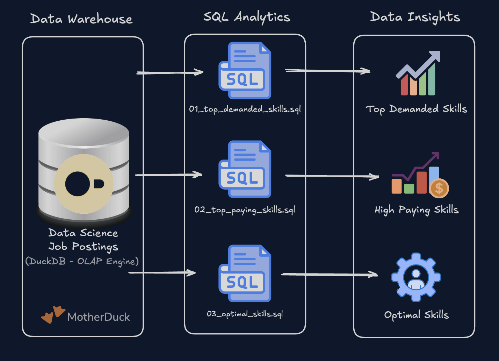
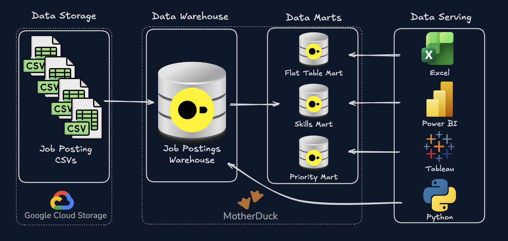

# SQL Data Engineering Projects  

The following projects are a collection of SQL projects that I have worked on to practice and reinforce my skill w/ data engineering tools.

> Click the project name below to view the tools used to build these!  

## Projects  

### [1. EDA](/1_EDA/) - Exploratory Data Analysis  

  

SQL - driven analysis of data engineer job market trends using advanced querying techniques.  

### [2_DW_Mart_Build/](/2_DW_Mart_Build/) - Data Pipeline - Data Warehouse & Mart

End-to-end ETL pipeline transforming raw CSV files into a star schema data warehouse and analytical data marts.

**Skills**: Dimensional modeling, ETL pipeline development, data mart architecture, production practices